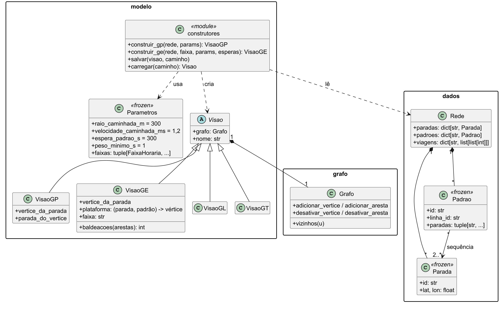

# Análise de redes de transporte público com grafos

Trabalho prático de Grafos (tema 5): uma ferramenta que lê os dados da rede de ônibus de Belo Horizonte no formato GTFS, monta grafos com estrutura e algoritmos próprios, sem bibliotecas prontas de grafo, e responde perguntas sobre trajetos, tempo de espera e eficiência da rede.

## 1. O problema

A ferramenta responde seis perguntas sobre a rede:

| Pergunta | Feature |
|---|---|
| Qual o trajeto mais rápido de A a B, somando caminhada, espera e viagem? | F-ROTA |
| Quanto tempo se espera, e como isso muda com o horário de saída? | F-ESPERA |
| Qual o trajeto com menos baldeações, e quanto tempo ele custa a mais? | F-BALD |
| Quais paradas são estruturalmente críticas para a rede? | F-MET |
| Quão eficiente é a rede, e quais regiões são mal atendidas? | F-EFI |
| O que acontece quando uma parada ou uma linha sai de operação? | F-RES |

A análise usa horários programados; não é navegação em tempo real. Detalhes em `docs/fontes/REQUISITOS.md`.

## 2. Os dados

GTFS dos ônibus de Belo Horizonte (BHTrans), do portal de dados abertos da PBH, com recorte por região ou por linhas. Uma rede de teste pequena, com respostas conhecidas, fica em `dados/rede-teste/`.

## 3. A modelagem

O mesmo dado vira visões de grafo diferentes, cada uma escolhida pela pergunta que responde:

| Visão | Vértices | Responde |
|---|---|---|
| G_P · paradas | Paradas | Centralidades, eficiência estrutural, falhas |
| G_E · parada × linha | Paradas e plataformas (parada, padrão de linha) | Trajeto mais rápido, espera, tempos origem-destino |
| G_L · linhas | Padrões de linha | Mínimo de baldeações |
| G_T · dependente do horário | Paradas, com partidas por aresta | Simulação com quadro de horários |

Um padrão é uma linha com uma sequência exata de paradas. Em G_E, trocar de linha obriga a desembarcar, voltar à parada e pagar um novo embarque, que carrega a espera; por isso um único Dijkstra soma caminhada, espera, viagem e baldeações. O tempo entre paradas é a mediana das viagens do dia típico, a caminhada liga paradas a até 300 m (1,2 m/s) e toda aresta de viagem ou caminhada tem piso de 1 s.

Justificativa, parâmetros, algoritmos e complexidades em `docs/fontes/modelagem.md` e na seção Modelagem do relatório (`relatorio/secoes/modelagem.tex`); decisões com o porquê em `docs/GUIA.md` §8; diagramas UML completos (classes, componentes e casos de uso) em `docs/diagramas/`.

## 4. Plano de desenvolvimento

Seis integrantes, cada um dono de uma frente de ponta a ponta. Divisão e tabela de features em `docs/plano-de-desenvolvimento/README.md`; método e calendário em `docs/fontes/plano-de-projeto.md`.

| Período | Datas |
|---|---|
| Fundação e Etapa 1 | 29/10 a 03/11 |
| Features essenciais | 04/11 a 11/11 |
| Features desejáveis; código congelado em 15/11 | 12/11 a 15/11 |
| Relatório, vídeo e entrega | 16/11 a 22/11 |

## 5. Como usar

_Instalação, ativação do hook, execução da interface e dos testes: seção a completar (P0-REPO)._

## 6. Documentação

- `docs/GUIA.md`: como a ferramenta funciona e por quê, e o registro de decisões.
- `docs/fontes/`: requisitos, modelagem e plano de projeto.
- `docs/plano-de-desenvolvimento/features/`: um arquivo por feature, com estado e próximo passo.
